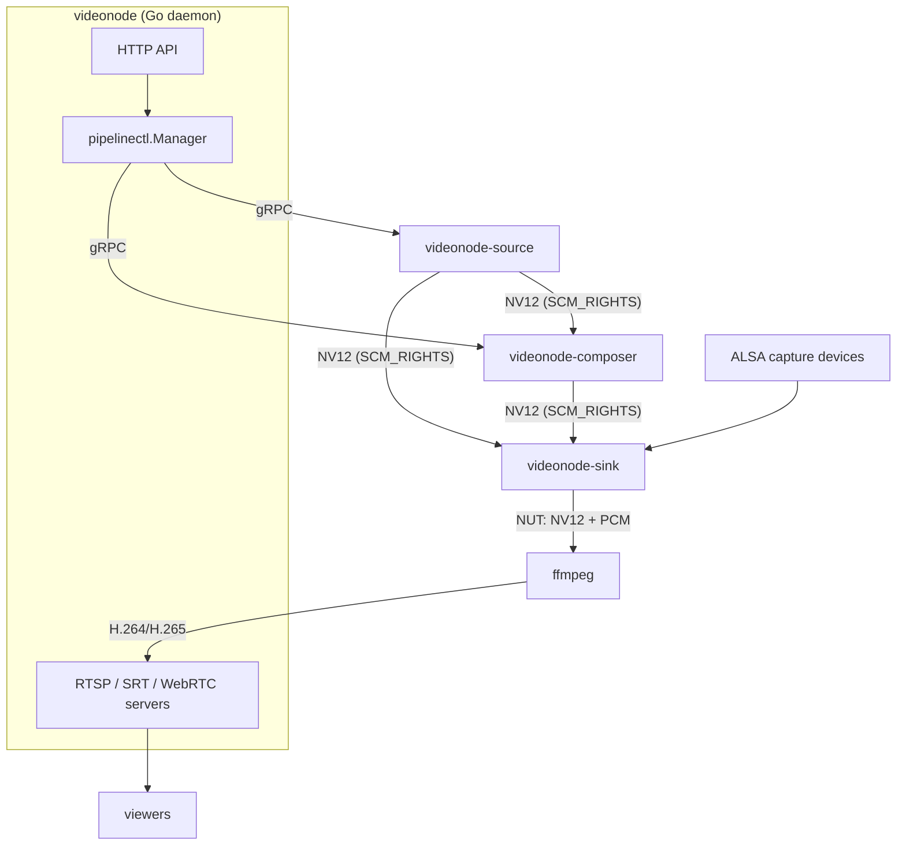

# Architecture

This page explains why VideoNode is structured as a Go daemon that supervises native C++ subprocesses, rather than a monolithic binary. It does not walk through setup steps. See [building](./building) for that, or [pipeline model](../reference/pipeline-model) for entity-level semantics.

## Why separate native binaries?

V4L2 capture, RGA color-space conversion, and libplacebo GPU compositing are CPU- and kernel-interface-heavy workloads that cannot run safely inside a Go process. Go's runtime scheduler conflicts with the real-time V4L2 buffer queue, and cgo boundaries at frame rate introduce latency spikes. Running the video work in separate C++ processes with dedicated OS threads eliminates both problems. The Go daemon manages policy and the HTTP API; the C++ binaries handle frames.

The three binaries are:

- `videonode-source`: V4L2 capture and RGA NV12 conversion, one process per source ID. Broadcasts NV12 dma-bufs to up to 16 consumers over a Unix socket. See [source inputs and formats](./source-and-formats) for input types, format detection, and subsampling conversion.
- `videonode-composer`: libplacebo GPU compositor (Vulkan where available, OpenGL otherwise). Reads NV12 dma-bufs from one or more source sockets, composites onto a BGRA canvas, then converts back to NV12 and broadcasts that NV12 canvas downstream.
- `videonode-sink`: the per-stream encoder feed. Dials a source or composer socket, captures the stream's ALSA audio devices itself, and writes paced NV12 video plus one PCM track per device to ffmpeg as a single NUT stream.

## Why the sink owns audio

ffmpeg keeps its output streams within about 100 ms of each other. When it reads video from a pipe and audio from ALSA as two separate inputs, whichever input stalls drags the other with it: an audio device that stops delivering samples without an error (a dsnoop recovery loop, HDMI audio after the signal drops) freezes the video encode, and a video gap stops ffmpeg reading ALSA until the capture buffer overruns. Once an unplugged device returns an error, ffmpeg also ends that input for good, so audio never comes back after a replug and players waiting on the empty audio track freeze.

`videonode-sink` therefore owns the audio devices and hands ffmpeg one already-interleaved input:

- Each device is read on its own thread that never blocks on ffmpeg. Xruns are recovered, a device that goes quiet for 2 s is reopened, and an unplugged device is retried every 500 ms. Card names (`hw:Lyra,0`) survive renumbering on replug.
- Gaps are filled with silence after 150 ms, so the audio track always carries packets and players never stall on it.
- Audio timestamps come from a delay-locked loop over the capture clock; ffmpeg's `aresample` async mode stretches to them, so camera-versus-host clock drift never accumulates and no samples are dropped or duplicated to correct it.
- Video is placed on a 1/fps grid by arrival time, and the last frame repeats when the producer goes quiet or restarts, so the encoder's video timeline keeps moving.
- The NUT stream is written in v4 pipe mode with a single syncpoint, because ffmpeg's NUT demuxer keeps every syncpoint it reads for the lifetime of the input.
- Stalls, unplugs, and recoveries are logged once per state change; xruns, filled silence, and dropped late audio are summarized at most once per 30 s, only when nonzero.

## Zero-copy frame passing with SCM_RIGHTS

Copying video frames over pipes at 30–60 fps would saturate memory bandwidth. Instead, `videonode-source` passes dma-buf file descriptors to consumers using `SCM_RIGHTS` ancillary data on a Unix socket. The consumer mmaps the kernel buffer directly, with no copy and no intermediate allocation. A serialized `dmabuf_header::Header` (NV12 plane offsets, pitches, frame index) precedes the file descriptors on the byte stream. This wire format is defined in `composer/src/ipc/dmabuf_header.hpp` and `dmabuf_header.cpp` (with the socket helpers in `scm_socket.cpp`); it is not compatible with the GStreamer `unixfdsrc` wire format.

Because `SCM_RIGHTS` supports N receivers on one socket, a single `videonode-source` can simultaneously feed a `videonode-composer` and one or more `videonode-sink` instances without any frame duplication.

## Per-instance gRPC control plane

The daemon needs to reconfigure running processes (swapping the V4L2 device, updating canvas dimensions, pushing layout changes) without restarting them. A daemon-wide message bus would serialize all control RPCs through one bottleneck; a per-instance Unix-domain socket keeps each binary's control path independent. The daemon dials each socket immediately after spawning the binary, calls `Describe()` to record PID and protocol version, then issues unary control RPCs as needed.

Sources expose: `Describe`, `SetFormat`, `SetDevice`, `GetStatus`, `StreamStatus` (server-streaming status push), `Snapshot`, `Shutdown`.

Composers expose: `Describe`, `SetCanvas`, `SetSource`, `ClearSource`, `SetLayout`, `SetEffects`, `SetSourceState`, `GetStats`, `Snapshot`, `Shutdown`.

The `StreamStatus` stream is the only long-lived RPC. The source pushes a `Status` frame on health change, on consumer-count change, and once per second as a heartbeat. The daemon's `pipelinectl.Manager` pumps these onto a buffered channel for the SSE fan-out path.

Wire schemas live in `proto/control/source.proto` and `proto/control/composer.proto`. Generated Go stubs are in `internal/streams/pipelinectl/pb/`.

The control-plane RPC messages are not duplicated on this site. The authoritative schema for every request and response (`SetFormat`, `SetCanvas`, `SetLayout`, `SetEffects`, and the shared `Status` and info types) is the `.proto` source: `proto/control/source.proto` and `proto/control/composer.proto` define the per-binary services, and `proto/control/common.proto` holds the types they share. Read those files when you need exact field names, types, and semantics.

## Process supervision contract

`videonode-source` sets `PR_SET_PDEATHSIG` so it receives `SIGTERM` if the daemon exits without a clean shutdown, preventing orphan processes. Sinks and composers reconnect to their source socket with 100 ms backoff for up to 30 s if the producer restarts. A sink crash does not take the source down. The daemon's `pipelinectl.Manager` evicts a source from its registry after 30 s of unresponsive `StreamStatus` reconnects.

## Relationship diagram

<!-- depicts: internal/streams/pipelinectl/manager.go:Manager + composer/README.md binary triad (rev as of 2deefb9) -->

For entity-level semantics (source, composer, stream lifecycles and CRUD), see [pipeline model](../reference/pipeline-model). For how the daemon pushes live state to the UI, see [events and SSE](./events-and-sse).
